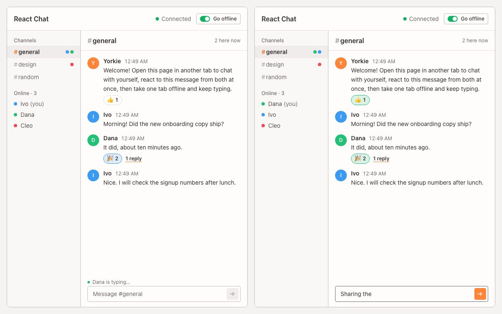

# React Chat

A Slack-like chat on Yorkie: channels, messages, emoji reactions, and
threads, with a rail that shows who is in which channel right now.

The thumbnail is a headless Chromium capture (Playwright, 2026-11-18) of
this example running against a local server: two panes side by side, a
third person in #design, a short conversation with a merged reaction and a
reply, and one pane typing.

## What to try

Open the page in two tabs (or add a user on yorkie.dev), then:

1. **Presence.** Switch channel in one tab: its dot moves in the other's
   rail. Start typing: the other shows "… is typing".
2. **Reactions at the same instant.** React to the same message with the
   same emoji from both tabs at once: the chip shows 2.
3. **History.** Open a third tab: it gets the day's conversation.
4. **Offline.** Press "Go offline" in one tab and send a few messages.
   The other tab sees that person leave. Go online again: they come back
   and their messages appear everywhere.

## How it is built

- **Documents.** One workspace document, `react-chat-<YYYYMMDD>`, holds the
  channel list, and its presence holds each person's name, color, open
  channel, and typing flag. Each channel is its own document,
  `react-chat-<YYYYMMDD>-<channel>`, attached only while it is open. Add
  `?key=<name>` to the URL to use a separate room.
- **Reactions** are `reactions[emoji][userId] = true`. Every message starts
  with an empty object per emoji, so two first reactions at once write two
  keys instead of racing to create the same one.
- **Threads** are a `replies` array inside the message.
- **Offline** switches both documents to `SyncMode.Manual` with
  `client.changeSyncMode`, and back to `SyncMode.Realtime`.
- **Identity** is made in memory on each load (the panes on yorkie.dev
  share storage). When two people get the same name or color, the one who
  joined later picks a free one.

The data rules live in [`src/model.ts`](src/model.ts) and are tested in
[`src/model.test.ts`](src/model.test.ts).

## How to run

1. Start the Yorkie server (from the repo root):
   `docker compose -f docker/docker-compose.yml up --build -d`
2. Install and build (from the repo root): `pnpm install` then `pnpm sdk build`
   and `pnpm react build`
3. `pnpm react-chat dev` (tests: `pnpm react-chat test`)
4. Open the printed URL in two tabs.

Each tab keeps two watch streams open, one per document. The local server
speaks HTTP/1.1, where a browser opens at most six connections to one host,
so more than two tabs of this example in one browser can stall. yorkie.dev's
server uses HTTP/2 and has no such limit. Locally, use a second browser or a
private window for a third person.
