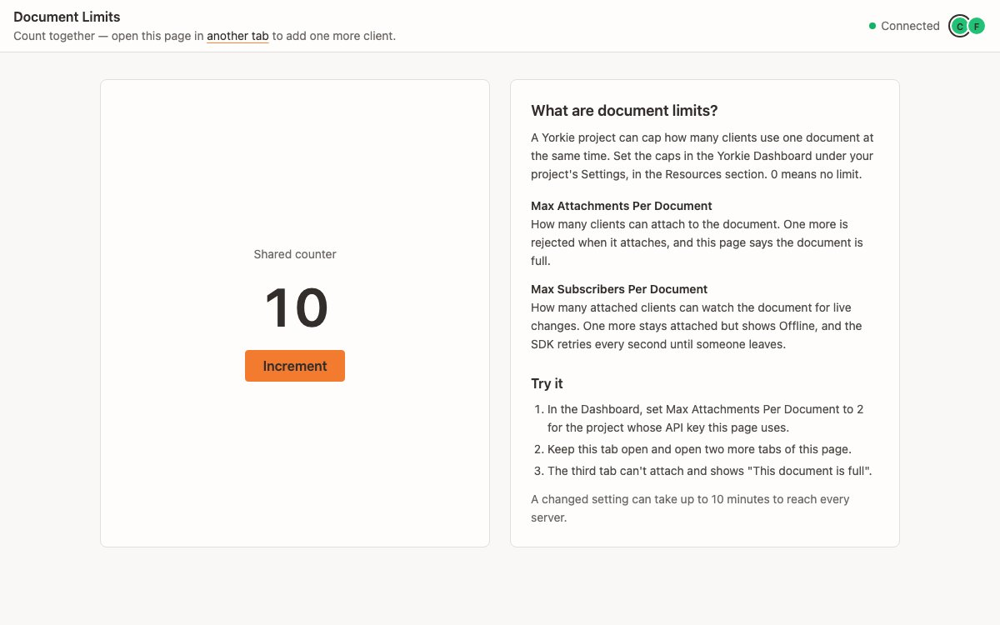

# Document Limits

A shared counter that shows what happens when a Yorkie project caps how many
clients can use one document. Built with `@yorkie-js/react`: `DocumentProvider`
holds a `Document` with a counter and `Presence` for the peer avatars. The
"attachment limit exceeded" rejection becomes a "This document is full" state.



## How to run

1. Start the Yorkie server (from the repo root):
   `docker compose -f docker/docker-compose.yml up --build -d`
2. Install and build (from the repo root): `pnpm install` then `pnpm sdk build`
3. `pnpm react-document-limit dev`
4. Open the printed URL in two tabs and click Increment in either one.

## Try the limits

Limits are set per project, either in the Yorkie Dashboard (your project's
Settings, Resources section) or with the CLI. `0` means no limit. See
[Resources](https://yorkie.dev/docs/advanced/resources) for details.

- **Max Attachments Per Document**: how many clients can attach to a document
  at once. One more is rejected when it attaches, and the page shows "This
  document is full".
- **Max Subscribers Per Document**: how many attached clients can watch the
  document for live changes. One more stays attached but shows Offline while
  the SDK retries every second.

To see it against the local server, set the limit on the `default` project
(the one used when `VITE_YORKIE_API_KEY` is empty):

```bash
docker compose -f docker/docker-compose.yml exec yorkie \
  yorkie login -u admin -p admin --insecure
docker compose -f docker/docker-compose.yml exec yorkie \
  yorkie project update default --max-attachments-per-document 2
```

Then open the page in three tabs; the third one says the document is full.
To use your own project, put its API key in `.env`. A changed setting can take
up to 10 minutes to reach every server.
