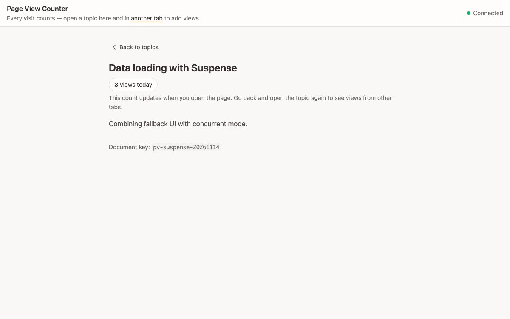

# Page View Counter

A daily page-view counter for a list of topics. Each topic page is a Yorkie
`Document` holding a `Counter`; opening the page adds one view with manual
sync (`SyncMode.Manual`), so it costs two RPCs and keeps no live stream open.



## How to run

1. Start the Yorkie server (from the repo root):
   `docker compose -f docker/docker-compose.yml up --build -d`
2. Install and build (from the repo root): `pnpm install` then `pnpm sdk build`
3. `pnpm react-page-view-counter dev`
4. Open the printed URL in two tabs and open the same topic in both. Counts
   refresh only when you enter a topic, so go back and open it again to see
   the other tab's view.

To point at a different server or use an API key, edit `.env` or set the
variables when starting the dev server:

```sh
VITE_YORKIE_API_ADDR=http://localhost:8080 \
VITE_YORKIE_API_KEY=your-key \
pnpm react-page-view-counter dev
```

## Pattern

- `DocumentProvider` with `syncMode={SyncMode.Manual}` and `disableGC`
- `YorkieProvider` with `deactivateOnUnload={false}` — skips the
  `beforeunload`/unmount-time `DeactivateClient` round trip. With
  `disableGC` and no collaboration cleanup needed, the unload-time
  deactivate is pure overhead and its `fetch({ keepalive: true })`
  can reject mid-navigation, surfacing as an unhandled
  `[unknown] ConnectError`. Server housekeeping reaps the stale
  client after `clientDeactivateThreshold`.
- Document key follows `pv-{topicId}-{YYYYMMDD}`, so a fresh document is
  used every 24 hours
- On topic-page mount, the client runs `counter.increase(1)` once and
  then calls `client.sync(doc)`
- No automatic sync afterwards — other users' increments are picked up
  on the next page entry

## RPCs per entry

Each time you open a topic page:

1. `attach`: push (empty change pack) + pull (server snapshot) — 1 RPC
2. `client.sync(doc)`: push (+1) + pull (any concurrent +1s) — 1 RPC

Two RPCs total. A strict "1 push + 1 pull" pattern requires mutating
the document *before* attach (a single `client.attach()` call carries
both push and pull). That path is not exposed by `DocumentProvider`, so
this example uses the two-RPC variant.

## Known simplifications

- The date in `docKey` uses the client's local time. A real service
  should pin the boundary to a fixed timezone (typically UTC) so every
  client agrees on the rotation moment.
- No server-side de-duplication, bot filtering, or per-user unique
  visitor logic.
- React StrictMode's double-effect is guarded with a ref. In
  production, refresh/back-button double counts should be handled by
  server-side policy.
