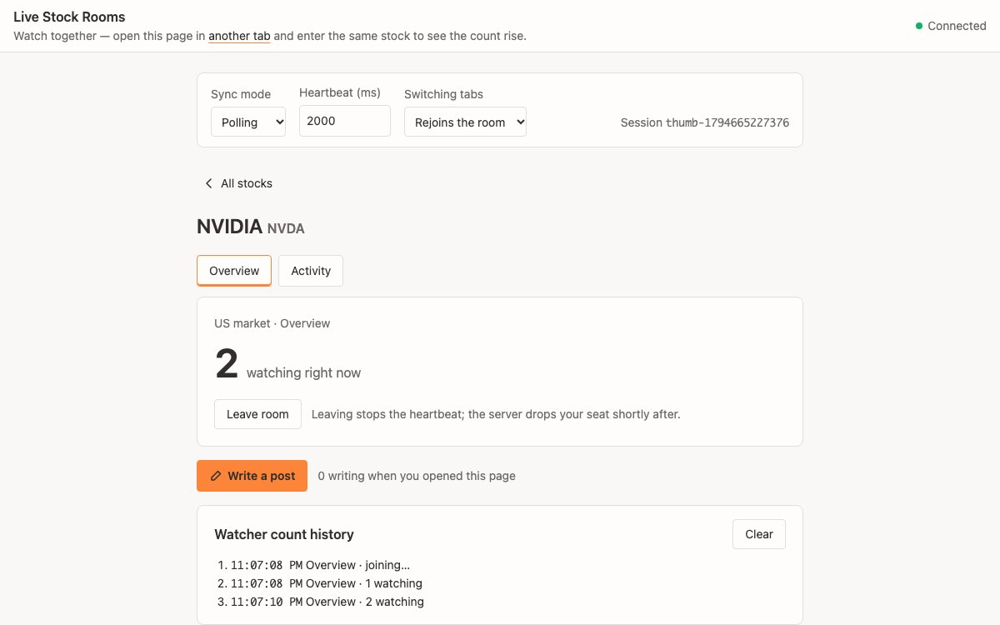

# Live Stock Rooms

A "who is watching this stock" demo built on Yorkie Channels in
`SyncMode.Polling`. Each ticker is its own `Channel`, and its `sessionCount`
is the number of clients in that room right now. A separate writers channel
is read with `usePeekChannel`, which returns its count without joining it.

## How to run

1. Start the Yorkie server (from the repo root):
   `docker compose -f docker/docker-compose.yml up --build -d`
2. Install and build (from the repo root): `pnpm install` then `pnpm sdk build`
3. `pnpm react-polling-playground dev`
4. Open the printed URL in two tabs and enter the same stock in both to see
   the count rise; send them into different stocks to see each room hold `1`.
   Click "Write a post" in one tab, and a stock page opened after that shows
   one more person writing.

## Controls

- **Sync mode**: `Polling` (heartbeat only) or `Realtime` (watch stream plus
  heartbeat), to compare how fast the count converges.
- **Heartbeat (ms)**: applied when a room attaches. Changing it while in a
  room attaches that room again.
- **Switching tabs**: where the `ChannelProvider` sits. "Rejoins the room"
  mounts one provider per Overview/Activity tab, so switching tabs detaches
  and attaches again, and the old seat counts until the server drops it.
  "Stays in the room" mounts one provider above the tabs, so the room stays
  attached.

The view lives in the query string (`?stock=NVDA&view=activity`), and `?key=`
picks the session prefix for all room keys (default: `trending-YYYYMMDD`).

## How it works

- The `YorkieProvider` uses `activate={false}`: this example only attaches
  Channels, so the client skips the eager activate/deactivate round trips and
  is activated by its first `RefreshChannel` heartbeat.
- `channelHeartbeatInterval` is applied at attach. The `ChannelProvider`
  remounts when the sync mode or heartbeat changes (via its `key`), which is
  fine for a demo; production code should call `client.changeSyncMode(...)`
  for live transitions.
- "Leave room" calls `useChannel().detach()`, which removes the channel from
  the client's `attachmentMap`, so no more `RefreshChannel` RPCs are sent. The
  server reclaims the session after its TTL. "Rejoin room" remounts the
  provider.
- The "Write a post" count comes from `usePeekChannel`: one RPC when the page
  opens, no attach, so viewers never become members of the writers channel.
  Opening the composer attaches to the writers channel as a participant.
- Errors from `useChannel()` and `usePeekChannel()` are shown inline.
- Polling channels do not receive broadcast events; this is by design.
- Each browser tab counts as one session per stock channel.
