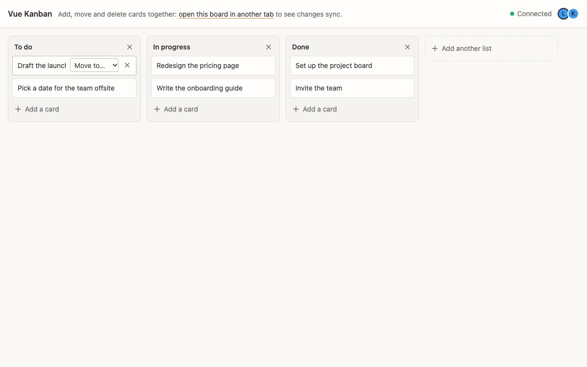

# Vue Kanban

    

A shared kanban board built with Vue and a Yorkie Document. Lists and cards
live in Yorkie Arrays: adding and deleting use `push` and `deleteByID`,
reordering within a list uses `moveBefore`/`moveLast`, and moving a card to
another list deletes it from one array and re-creates it in the other within
a single update. Presence shows who else is on the board.

## How to run

1. Start the Yorkie server (from the repo root):
   `docker compose -f docker/docker-compose.yml up --build -d`
2. Install and build (from the repo root): `pnpm install`, then
   `pnpm sdk build`
3. `pnpm vuejs-kanban dev`
4. Open the printed URL in two tabs (or two browsers), then add, drag or
   "Move to…" a card in one to see it change in the other.

The document key ends in today's date (`vuejs-kanban-YYYYMMDD`), so a fresh
board with the example cards starts every day.

Because a move to another list is a delete plus an insert, two people moving
the same card to other lists at the same moment end up with two copies of it,
and a move made at the same moment as a delete brings the card back.
